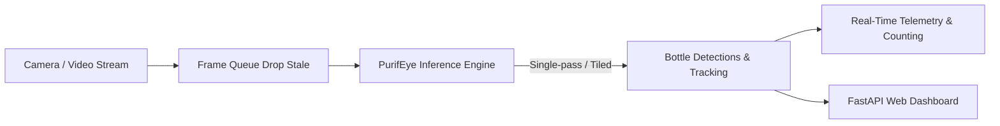

# LearnProject — Understanding PurifEye: River Plastic Bottle Detection

Welcome to the PurifEye learning guide! This document explains how computer vision, object detection, edge deployment, and real-time processing work together to combat plastic pollution in our rivers and waterways.

---

## 1. The Project in Two Minutes
Plastic waste flowing through rivers accounts for the majority of ocean plastic. To stop marine pollution, intercepting waste at the river level is essential. PurifEye is an AI platform built to detect and count floating plastic bottles from bank cameras, bridges, drones, and edge devices—operating entirely on standard CPU hardware.

### High-Level Architecture

### Outcome Summary
| Model Variant | Input Mode | Precision | Recall | mAP@50 | Latency (CPU) |
|---|---|---|---|---|---|
| *To be populated in Stage 12 with verified Part 2 results* | | | | | |

---

## 2. ML Approach at a Glance
- **What is Object Detection?** Unlike image classification (which labels the entire image "water" or "bottle"), object detection finds *where* objects are by predicting rectangular bounding boxes `(x, y, width, height)` and assigning a class probability score.
- **Confidence Score:** A number between 0.0 and 1.0 representing the model's certainty that a box contains a plastic bottle.
- **Intersection over Union (IoU):** The ratio of the overlapping area between two bounding boxes divided by their combined union area. An IoU of 0.5 means a 50% overlap.
- **Non-Maximum Suppression (NMS):** When a detector spots a bottle, it often produces dozens of overlapping boxes. NMS keeps only the highest-confidence box and removes boxes that overlap with it above a given IoU threshold.
- **Transfer Learning:** Instead of training a neural network from scratch on millions of images, we start with weights pretrained on Microsoft COCO (80 common object classes). The network already knows basic edges, shapes, and textures, and only needs to specialize in river plastic bottles.

---

## 3. Dataset & Preprocessing
- **Source:** 5,592 images captured across 34 field sessions along rivers in Indonesia, India, Nepal, Pakistan, Bangladesh, and Bosnia.
- **Pascal VOC vs. YOLO Format:**
  - *Pascal VOC:* XML files containing pixel coordinates `[xmin, ymin, xmax, ymax]`.
  - *YOLO:* Plain text `.txt` files containing normalized coordinates `[class_id, x_center, y_center, width, height]` scaled between 0.0 and 1.0 relative to image width and height.
- **Leakage-Safe Splitting:** Many images were taken seconds apart from the same river bank. Randomly shuffling images into train and test splits would cause spatial data leakage (the test set would contain identical scenes). PurifEye groups by session/scene to ensure the test split tests true generalization.
- **Why Tiling Helps:** Distant bottles occupy as few as 10x10 pixels in a 4K image. Downscaling a 4K image to 640x640 turns small bottles into sub-pixel blur. Splitting the image into overlapping 640x640 tiles preserves high-frequency detail.

---

## 4. Models: AutoML TFLite vs YOLOv8
- **MobileNet-SSD (AutoML TFLite):** An ultra-lightweight (~2.8 MB) edge detector. High efficiency per parameter, but historically slow under single-threaded CPU interpreters unless properly configured with multithread delegates.
- **YOLOv8 Nano (YOLOv8n):** A modern anchor-free single-stage detector featuring a CSPDarknet backbone, PAN-FPN feature pyramid, and decoupled detection head. Extremely fast, robust on overlapping objects, and natively exportable to OpenVINO and ONNX.

---

## 5. CPU Training Strategy & Budgeting
- **Hardware Calibration:** Measuring iterations per second on a small 20-batch slice allows calculating exact epoch limits matching the user's unattended compute budget.
- **Key Hyperparameters:**
  - *Cosine Learning Rate Schedule:* Gradually decreases learning rate following a cosine curve for smooth convergence.
  - *Backbone Freezing:* Freezes feature extraction layers during the initial epochs to prevent corrupting pretrained representations while the detection head adapts.
  - *Targeted Augmentation:* Water-reflective glare shifts, river turbidity color perturbations, subtle scaling, and mild affine transformations without violating river scene physics (no vertical flips of floating bottles).

---

## 6. Validation & Testing Metrics Explained
- **Precision:** $TP / (TP + FP)$ — When the model says "bottle", how often is it right?
- **Recall:** $TP / (TP + FN)$ — Out of all bottles in the river, what percentage did the model find?
- **F1 Score:** Harmonic mean of Precision and Recall ($2 \times \frac{P \times R}{P + R}$). The optimal confidence threshold is chosen where validation F1 is maximized.
- **mAP@50:** Mean Average Precision at IoU 0.50 threshold.
- **mAP@50-95:** Average mAP across 10 IoU thresholds from 0.50 to 0.95 in 0.05 steps.

---

## 7. Intelligent Inference & Real-Time Streaming
- **Tiled Merging:** Tiles are processed in a single batch. Box coordinates are remapped to full-frame space and unified using coordinate-scaled soft-NMS.
- **Persistent Tracking:** Rather than treating each frame independently, a lightweight centroid/Kalman tracker assigns stable IDs (`Bottle #14`) across frames.
- **Producer-Consumer Threading:** 3 isolated threads:
  1. *Capture Thread:* Always grabs the newest camera frame.
  2. *Inference Thread:* Reads the newest frame and drops older unprocessed frames if the detector is running slower than capture.
  3. *Render Thread:* Draws HUD telemetry and streams to the display or web client.

---

## 8. Edge Deployment & Formats
- **ONNX (Open Neural Network Exchange):** Cross-platform standard for hardware-accelerated runtimes.
- **OpenVINO:** Intel-optimized runtime providing maximum CPU vectorization (AVX-512 / VNNI).
- **TFLite (FP16 & INT8):** Quantized representations suitable for ARM edge devices (Raspberry Pi, Coral TPU).

---

## 9. Dashboard Architecture
Built with FastAPI and vanilla JavaScript with zero third-party UI framework dependencies. Every screen uses the strict PurifEye Charcoal Navy (`#242649`) and Sky Blue (`#65A7D3`) design system.

---

## 10. Check Your Understanding
1. *Why is accuracy usually low when training directly on 512x512 downsampled river images?*
   Because distant floating bottles become smaller than a single pixel feature map cell.
2. *Why must scene-grouped splits be used instead of random splits?*
   To prevent same-minute photographs from leaking between training and test sets.
3. *What is the benefit of single-slot dropping queues in real-time video processing?*
   Prevents lag accumulation by ensuring inference always runs on the freshest camera frame.

*(Full results, ablation curves, and edge benchmarks will be finalized in Stage 12)*
