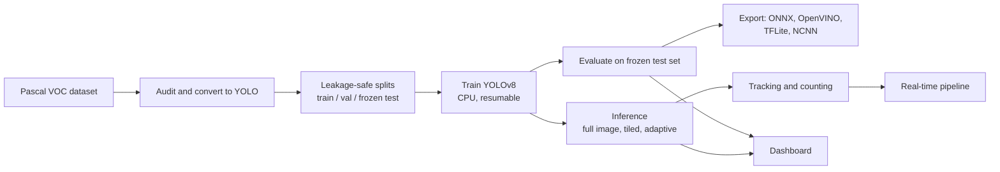

# PurifEye

**CPU-friendly AI that detects and counts floating plastic bottles in rivers from images, video and a live webcam.**

PurifEye is an end-to-end computer vision project for finding plastic bottles in waterways. It combines a modern **Ultralytics YOLOv8** pipeline with a lightweight **TensorFlow Lite** model for edge devices, uses **tiled inference** to catch small, distant bottles, and ships with a themed web dashboard. It is designed to run on an ordinary CPU, with no GPU required.

---

## Table of contents

1. [Features](#features)
2. [How it works](#how-it-works)
3. [Dataset](#dataset)
4. [Model evaluation](#model-evaluation)
5. [Project structure](#project-structure)
6. [Getting started](#getting-started)
7. [Usage](#usage)
8. [Training](#training)
9. [Evaluation protocol](#evaluation-protocol)
10. [Tiled inference](#tiled-inference)
11. [Real-time pipeline](#real-time-pipeline)
12. [Edge deployment](#edge-deployment)
13. [Dashboard](#dashboard)
14. [Design system](#design-system)
15. [Limitations](#limitations)
16. [Roadmap](#roadmap)
17. [Learn more](#learn-more)
18. [Acknowledgements and licence](#acknowledgements-and-licence)

---

## Features

- **Real-time webcam detection.** A multi-threaded pipeline (capture, inference, display) with stale-frame dropping so the camera never freezes or lags. The target is 30+ FPS on CPU; measured results are reported in the [evaluation table](#model-evaluation).
- **Edge deployment.** A lightweight Google AutoML MobileNet-SSD model (`.tflite`, 2.76 MB) suitable for devices such as the Raspberry Pi, plus exports to ONNX, OpenVINO, TFLite (fp16 and int8) and NCNN.
- **Modern YOLOv8 pipeline.** Custom training with pause and resume, and high-accuracy detection on images, video and webcam, using custom or COCO weights.
- **3×3 tiling inference.** Slices high-resolution river images into overlapping tiles to improve detection of distant, small bottles, then merges the results.
- **Dataset converter.** A built-in script that converts Pascal VOC XML annotations to YOLO format, with validation and logging of invalid labels.
- **Unique counting.** Object tracking assigns each bottle a persistent ID so the same bottle is counted once, not once per frame.
- **Dashboard.** A local web app for live detection, image analysis, video batch processing, model comparison and evaluation results.

---

## How it works



The project keeps two operating points:

| Mode | Purpose | How |
|---|---|---|
| **Accurate** | Best detection quality on still images and recordings | Overlapped tiled or adaptive inference |
| **Live** | Smooth real-time video on CPU | Single pass at a smaller inference size, fastest CPU backend |

---

## Dataset

The models are trained on the **5,592 Plastic Bottles in Rivers** dataset in Pascal VOC format, containing images of floating plastic pollution from rivers in **Indonesia, India, Nepal, Pakistan, Bangladesh and Bosnia**.

Key steps in how the data is handled:

- **Audit.** Image sizes, empty or invalid annotations, near-duplicates (perceptual hashing), box-size distribution and the share of small objects are reported before training.
- **Conversion.** Boxes are normalised using each image's true width and height, clamped to the image, and invalid boxes are dropped with a logged reason. Converted labels are drawn back onto sample images to prove the conversion is correct.
- **Splits.** Train, validation and a **frozen test split** that is never used for tuning. Near-duplicates and images of the same scene are kept on one side of the split to prevent leakage. A manifest is saved so every model is scored on identical test images.
- **Tiled training subset.** Overlapped tiles (about 640 px, roughly 20% overlap) are generated for training and capped in size to keep CPU training practical. Validation and test remain full images.

> Dataset licence and attribution: please see the dataset's original source and respect its licence terms. The dataset itself is not redistributed in this repository.

---

## Model evaluation

Baselines from the original project, measured on CPU:

| Model | Input Size | Precision | Recall | mAP@50 | Latency (CPU) |
|---|---|---|---|---|---|
| YOLOv8 Nano (Custom) | 512 × 512 | 46.8% | 15.2% | 14.6% | ~59 ms (~17 FPS) |
| AutoML TFLite (Baseline) | 512 × 512 | 55.2% | 48.7% | 38.0% | ~1,770 ms (0.5 FPS) |
| AutoML (3×3 Tiled) | 3 × 3 tiles | 56.5% | 59.1% | 54.0% | ~15,000 ms (0.06 FPS) |

**Improved results (this project):**

| Model | Input Size | Precision | Recall | mAP@50 | Latency (CPU) |
|---|---|---|---|---|---|
| _To be filled from `reports/` after the final run_ | | | | | |

> Every figure in this table should state the split, confidence and IoU thresholds, hardware and thread count. Results from smoke tests are labelled as such and are not real results.

**Targets:** beat the best baseline on the frozen test split (precision above 56.5%, recall above 59.1%, mAP@50 above 54.0%) with far lower latency than 15 seconds, and reach real-time speed in Live mode as far as the CPU allows.

---

## Project structure

```text
.
├── detect.py                    # TFLite inference (single image, 3x3 tiling, threaded webcam)
├── detect_yolo.py               # YOLOv8 inference (image, video, webcam, custom or COCO weights)
├── train_yolo.py                # YOLOv8 training with pause and resume
├── prepare_yolo_dataset.py      # Pascal VOC XML to YOLO converter
├── evaluate.py                  # Unified evaluation harness for every model
├── export_models.py             # ONNX, OpenVINO, TFLite and NCNN export and benchmarking
├── realtime.py                  # Threaded real-time pipeline
├── purifeye/                    # Shared package: config, tiling, merging, metrics, tracking, plot theme
├── app/                         # Dashboard (FastAPI backend and HTML/CSS/JS frontend)
├── configs/                     # Configuration files
├── tests/                       # Automated tests
├── docs/                        # Documentation and model card
├── reports/                     # Evaluation results and plots read by the dashboard
├── Plastic-Bottle-Detection-Models/   # Pre-trained TFLite (.tflite) and Protobuf (.pb) models
├── yolo_dataset/                # YOLO dataset configuration (data.yaml) and splits
├── runs/                        # Training weights, confusion matrices and metrics
├── pyproject.toml               # Dependencies (managed with uv)
├── uv.lock                      # Locked dependency versions
├── LearnProject.md              # Plain-language guide to the ML approach
└── README.md
```

---

## Getting started

### Requirements

- Python 3.10 or newer
- [uv](https://docs.astral.sh/uv/) for environment and dependency management
- A webcam (optional, for live detection)
- No GPU is needed

### Install

```bash
git clone https://github.com/ManasKrishna-21/PurifEye.git
cd PurifEye
uv sync
```

`uv sync` creates the virtual environment and installs the exact versions from `uv.lock`. Run every command through `uv run` so it uses that environment.

### Prepare the dataset

Place the Pascal VOC dataset in the data folder (it is git-ignored), then convert and split it:

```bash
uv run python prepare_yolo_dataset.py --help
```

Run it with the options shown in the help output. This writes YOLO labels, the train, validation and test splits and `yolo_dataset/data.yaml`.

---

## Usage

Each script documents its own options. Check them with `--help`:

```bash
uv run python detect_yolo.py --help
uv run python detect.py --help
uv run python realtime.py --help
```

Typical tasks:

| Task | Script |
|---|---|
| Detect bottles in an image or video with YOLOv8 | `detect_yolo.py` |
| Detect with the TFLite edge model, including 3×3 tiling | `detect.py` |
| Run the live webcam pipeline | `realtime.py` |
| Train or resume YOLOv8 training | `train_yolo.py` |
| Score any model on the frozen test split | `evaluate.py` |
| Export models and benchmark them | `export_models.py` |

---

## Training

Training is designed for a CPU-only machine:

- **Pretrained start.** YOLOv8 Nano initialised from COCO weights, with the backbone frozen for the first few epochs.
- **Time-budgeted.** Epoch counts are derived from measured CPU throughput and the compute time available.
- **Short ablations first.** A few quick experiments on a subset (image size, full-image versus tiled training, augmentation preset, model size) select the best configuration, then one long final run trains it.
- **Augmentation for water scenes.** Scale and translate, colour shifts for water tone and glare, motion blur, brightness changes and copy-paste for sparse bottles. Nothing that breaks water-scene physics.
- **Resumable.** Last and best weights are saved every epoch, so training survives a closed terminal, a crash or a reboot. Run the same training command again to continue.
- **Logged.** Curves, the confusion matrix and a run registry (CSV with configuration, metrics and notes) are saved under `runs/` and `reports/`.

```bash
uv run python train_yolo.py --help
```

---

## Evaluation protocol

All models, including the AutoML baselines and exported formats, are scored identically on the **frozen test split**:

- Metrics: precision, recall, F1, mAP@50, mAP@50-95, per-size recall and AP (small, medium, large), PR curve and confusion matrix.
- The confidence threshold that maximises F1 is chosen on validation and applied to test.
- Latency: warm-up runs, median and 95th percentile, fixed thread count, batch size 1, model load time excluded, with preprocessing, inference and post-processing reported separately.
- Very slow models may be scored on a fixed subset of the test split. In that case every model is also reported on the same subset so comparisons stay fair.

```bash
uv run python evaluate.py --help
```

---

## Tiled inference

Distant bottles can be only a few pixels wide, so single-pass inference at a small size often misses them. Tiled inference helps by:

1. Splitting the image into **overlapping tiles** (about 20% overlap, configurable grid) so bottles on tile borders are not cut.
2. Running all tiles **as one batch**.
3. Converting detections back to full-image coordinates, then applying class-aware non-maximum suppression and merging fragments of the same bottle.

**Adaptive tiling** runs the full image first and tiles only when the image is high resolution or full-image confidence suggests small distant objects. This keeps most frames fast.

---

## Real-time pipeline

`realtime.py` runs three cooperating threads:

| Thread | Job |
|---|---|
| Capture | Always reads the newest camera frame |
| Inference | Detects on the latest frame only |
| Render | Draws boxes and telemetry and shows the result |

They are connected by single-slot queues that **drop stale frames**, so delay never builds up. Threads and queues are used instead of async code to keep the design simple.

Live telemetry shows FPS, capture-to-display latency, inference time, dropped frames, detections and the unique-bottle count. Sources can be a webcam, a video file or a stream URL. If no camera is found, it falls back to a video file.

---

## Edge deployment

`export_models.py` exports the best model to:

- **ONNX**
- **OpenVINO** (fast on Intel CPUs)
- **TFLite** (float16 and int8, calibrated on representative training images)
- **NCNN** (for Raspberry Pi class devices)

Every export is re-evaluated after conversion. A drop of more than 2 points of mAP@50 is flagged. A recommendation matrix lists the best format for laptop CPU real-time, Raspberry Pi and maximum accuracy. The 2.76 MB AutoML MobileNet-SSD `.tflite` remains the ultra-light fallback.

---

## Dashboard

A local web app (FastAPI backend, hand-built HTML, CSS and JavaScript frontend):

| Page | What it does |
|---|---|
| Live Detect | Webcam, video file or stream with a telemetry strip |
| Image Analyzer | Upload an image and choose full, tiled or adaptive mode, with confidence and overlap controls |
| Video Batch | Process a video and download the annotated output and detection log |
| Model Lab | Compare two models side by side on the same input |
| Evaluation | Results table, PR curve, confusion matrix and experiment history |
| Dataset Explorer | Class and size distributions, samples with ground-truth overlays |
| Edge Benchmarks | Export comparison across formats |
| About / Model Card | Intended use, data, metrics and limitations |

The dashboard reads its numbers from files in `reports/`. Whenever the data comes from a smoke test, it shows a visible **SMOKE TEST** banner.

Start it with the app command defined in `pyproject.toml`, for example:

```bash
uv run python -m app
```

(Use the exact command listed in `pyproject.toml` if it differs.)

---

## Design system

The interface uses a blue-only, eco-industrial dark theme. Colours are defined once as design tokens and shared by the app and every saved plot.

| Colour | Hex | Role |
|---|---|---|
| Charcoal Navy | `#242649` | Base canvas and recessed wells |
| Deep Midnight Indigo | `#222B68` | Cards and panels |
| Dark Royal Blue | `#23337C` | Raised or hovered surfaces |
| Deep Sapphire | `#263B84` | Pressed states, chart ramp |
| Muted Denim | `#364989` | Borders, gridlines, dividers |
| Steel Blue | `#386CAF` | Primary actions, selected states |
| Sky Blue | `#65A7D3` | Detection boxes, crosshair brackets, highlights |
| Powder Blue | `#B2D3EB` | Secondary text, focus rings |
| Ice Blue | `#CDDFEF` | Table headers, high-contrast boxes |
| Pure White | `#FFFFFF` | Headlines and key metrics |

Typography: **Space Grotesk** for headings, **Plus Jakarta Sans** for body text and **JetBrains Mono** for telemetry and metrics, with tabular numerals so live values do not jitter.

---

## Limitations

- Trained on river imagery from six regions. Performance may drop in other water types, turbid or foamy water, heavy glare, night scenes and partly submerged or crushed bottles.
- The model detects plastic **bottles** only, not other floating plastic waste.
- CPU-only training limits model size and training length. Larger models or longer training would likely improve accuracy.
- Live-mode FPS depends on your CPU. Report the real FPS for your hardware rather than assuming the target.

---

## Roadmap

- More regions, night footage and additional plastic waste classes
- Segmentation to estimate bottle size
- An active-learning loop to find and correct missing labels
- GPS-tagged detection logs for deployed units
- Serving detection as an API
- Deployment on a boat- or bridge-mounted Raspberry Pi unit

---

## Learn more

[`LearnProject.md`](LearnProject.md) explains the ML approach in plain language: the dataset, the models used, training, validation, testing and the dashboard, with the project's real results.

---

## Acknowledgements and licence

- Dataset: *5,592 Plastic Bottles in Rivers* (Pascal VOC format). Please credit the original authors and follow their licence.
- [Ultralytics YOLOv8](https://github.com/ultralytics/ultralytics) for the detection framework (note its AGPL-3.0 licence terms).
- TensorFlow Lite and Google AutoML for the edge model.

Add your own licence file (for example `LICENSE`) and name it here once chosen.
