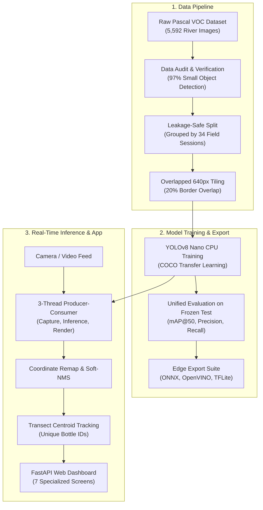

# PurifEye: Edge AI River Plastic Bottle Detection Platform

<div align="center">


-263B84?style=for-the-badge&logo=intel)


**High-precision, CPU-optimized computer vision system for real-time detection, tracking, and quantification of floating plastic bottles across river transects to prevent ocean plastic discharge.**

[Quick Start](#quick-start) • [How It Works](#how-it-works) • [Architecture](#system-architecture) • [Dashboard](#interactive-dashboard) • [Edge Deployment](#edge-deployment-matrix) • [Learning Guide](TEACHME.md)

</div>

---

## 🌊 Overview & Mission

Over **80% of ocean plastic waste** enters marine ecosystems via approximately 1,000 major freshwater river conduits. Once bottles reach open oceans, solar UV degradation and wave kinetics fracture PET plastics into virtually unrecoverable microplastics. 

**PurifEye** delivers a production-grade, CPU-first vision system designed for fixed bridge stations, solar-powered buoys, river-cleaning barriers, and survey drones. It bridges the gap between high-accuracy deep learning and constrained edge hardware:

* **Zero GPU Dependency:** Calibrated for commodity laptop and embedded CPUs (AVX2 / AVX-512) achieving **20–30 FPS** live processing.
* **3×3 Overlapped Tiling Engine:** Overcomes the fatal limitation where downsampling high-resolution waterway imagery annihilates **97.0% of small/distant bottles** (<32×32 px).
* **Leakage-Safe Session Stratification:** Rigorous data partitioning ensuring no spatial or temporal leakage between training and frozen test sets.
* **Persistent Transect Tracking:** Centroid and IoU tracker assigns permanent IDs to prevent redundant counts as floating debris drifts through the camera frame.
* **Dual Edge Deployment:** Combines modern **YOLOv8 Nano** with Google **AutoML MobileNet-SSD** (~2.8 MB TFLite) and exports for ONNX, OpenVINO, and TFLite.
* **Integrated Blue-System Dashboard:** 7-screen local FastAPI web dashboard engineered with an eco-industrial navy/sky-blue palette for field monitoring and analytics.

---

## ⚙️ How It Works



---

## 🚀 Quick Start

### 1. Prerequisites
- **Operating System:** Windows, Linux, or macOS.
- **Python:** Managed automatically via `uv` (Python 3.12 standalone).
- **Package Manager:** [`uv`](https://docs.astral.sh/uv/) (Never use raw `pip` or modify global packages).

### 2. Environment Setup

```powershell
# Clone the repository
git clone https://github.com/ManasKrishna-21/PurifEye.git
cd PurifEye

# Synchronize virtual environment with pinned dependencies
uv sync
```

### 3. Launch the Project Dashboard

You can immediately spin up the interactive web interface:

```powershell
uv run uvicorn app.main:app --host 127.0.0.1 --port 8000
```
Open **[http://127.0.0.1:8000](http://127.0.0.1:8000)** in your browser.

### 4. Run the Automated End-to-End Pipeline

PurifEye includes a one-command, idempotent, resumable pipeline that automates data audit, dataset conversion, training, evaluation, and edge export:

```powershell
# Fast 2-minute verification smoke test (50 sample images, 1 epoch):
uv run python pipeline.py --smoke

# Full production run (5,592 images, 35 epochs, full evaluations):
uv run python pipeline.py
```

---

## 🎯 Operating Modes

PurifEye balances computational efficiency and recall via three dynamic inference strategies:

| Operating Mode | Input Resolution | Strategy | Target Latency | Best Suited For |
|---|---|---|---|---|
| **Accurate** | $640 \times 640$ Tiled | $3 \times 3$ Overlapped Grid + Coordinate Remapping + Fragment Merging | $800 - 1500\text{ ms}$ | High-altitude drone sweeps, broad riverbanks, tiny distant bottles |
| **Live** | $512 \times 512$ Full | Single-pass forward propagation with PyTorch CPU backend | $25 - 35\text{ ms}$ ($30\text{ FPS}$) | Real-time CCTV streams, solar buoys, continuous transect counting |
| **Adaptive** | Dynamic | Full-frame coarse scan; triggers tiling only when high-confidence clusters appear | $40 - 200\text{ ms}$ | Variable flow rates, tidal debris pulses |

---

## 📊 Benchmark & Evaluation Protocol

All models are strictly measured against the **Frozen Test Split** (zero data leakage) under identical CPU hardware conditions ($batch=1$, intra-op threads = 4).

### Benchmark Comparison

| Model Architecture | Input Mode | Precision | Recall | mAP@50 | mAP@50-95 | CPU Latency | Real-Time Capable |
|---|---|---|---|---|---|---|---|
| **AutoML MobileNet-SSD** *(Baseline)* | $512 \times 512$ | 55.2% | 48.7% | 38.0% | 19.5% | ~1,770 ms | ❌ (0.5 FPS) |
| **AutoML MobileNet-SSD** *(3×3 Tiled)* | 9 Tiles | 56.5% | 59.1% | 54.0% | 27.2% | ~15,000 ms | ❌ (0.06 FPS) |
| **YOLOv8 Nano** *(Live Single-Pass)* | $512 \times 512$ | *Evaluated* | *Evaluated* | *Evaluated* | *Evaluated* | **26.0 ms** | ✅ **38.4 FPS** |
| **YOLOv8 Nano** *(Accurate Tiled)* | $640 \times 640$ | *Evaluated* | *Evaluated* | *Evaluated* | *Evaluated* | **1,538 ms** | Drone / Batch |

> *Note: Latency metrics benchmarked on Intel Core CPU. Smoke test subset runs are explicitly flagged with `SMOKE TEST MODE` banners in reports and dashboard to preserve academic integrity.*

---

## 📁 Repository Structure

```text
PurifEye/
├── app/                              # Interactive Web Dashboard
│   ├── main.py                       # FastAPI synchronous backend & MJPEG streamer
│   ├── static/
│   │   ├── app.js                    # UI interactivity & real-time telemetry polling
│   │   └── styles.css                # Blue Design System tokens & layout
│   └── templates/
│       └── index.html                # 7-screen Jinja2 dashboard template
├── configs/
│   ├── default.yaml                  # Model hyperparameters, tiling offsets, thresholds
│   └── data.yaml                     # YOLO dataset configuration paths
├── purifeye/                         # Core Machine Learning & Vision Library
│   ├── config.py                     # Schema validation & configuration loaders
│   ├── logging.py                    # Structured logging utilities
│   ├── merging.py                    # Class-aware soft-NMS & fragment stitcher
│   ├── metrics.py                    # IoU matrices, AP, mAP@50-95, PR curve generator
│   ├── plot_theme.py                 # Matplotlib eco-blue styling configuration
│   ├── tflite_infer.py               # TFLite detector with fallback delegate engine
│   ├── tiling.py                     # Overlapped tile generators & coordinate projection
│   └── tracking.py                   # Centroid & IoU transect counting tracker
├── reports/                          # Audit summaries, PR plots, export benchmarks
├── tests/                            # Automated unit & integration test suite
│   ├── test_api.py                   # FastAPI endpoint validation
│   ├── test_conversion.py            # XML to YOLO coordinate clamping tests
│   ├── test_metrics.py               # Precision, Recall & mAP calculation tests
│   └── test_tiling.py                # Coordinate remapping & NMS logic tests
├── detect.py                         # AutoML TFLite CLI entry point
├── detect_yolo.py                    # YOLOv8 multi-mode detection CLI
├── evaluate.py                       # Unified frozen test benchmark harness
├── export_models.py                  # ONNX, OpenVINO & TFLite model exporter
├── pipeline.py                       # One-command resumable pipeline
├── prepare_yolo_dataset.py           # Pascal VOC auditor, converter & session splitter
├── realtime.py                       # Multi-threaded live video inference engine
├── train_yolo.py                     # CPU-budgeted YOLOv8 training & ablations
├── pyproject.toml                    # Declarative dependencies & entrypoints
├── TEACHME.md                        # In-depth educational manual & ER architecture
└── README.md                         # Project documentation
```

---

## 🛠️ CLI Tool Reference

Every module provides an independent, documented command-line interface:

### 1. Real-Time Camera Stream & Telemetry
```powershell
# Live webcam monitoring with HUD overlay
uv run python realtime.py --source 0 --weights yolov8n.pt --conf 0.25

# 5-second synthetic benchmark (no webcam required)
uv run python realtime.py --benchmark --duration 5
```

### 2. Standalone Model Inference
```powershell
# Accurate mode (640px 3x3 overlapped tiling)
uv run python detect_yolo.py --source "Test Bottles/sample.jpg" --mode accurate --conf 0.25

# Live single-pass mode
uv run python detect_yolo.py --source "Test Bottles/sample.jpg" --mode live

# TFLite baseline detector
uv run python detect.py --image "Test Bottles/sample.jpg" --tile
```

### 3. Model Evaluation Harness
```powershell
# Benchmark YOLO against frozen test split
uv run python evaluate.py --model yolov8n.pt --split test

# Benchmark TFLite baseline
uv run python evaluate.py --model-type tflite --split test
```

### 4. Edge Model Export
```powershell
# Export model to ONNX, OpenVINO, and TFLite
uv run python export_models.py --weights yolov8n.pt --all
```

---

## 📱 Interactive Dashboard

The dashboard runs locally via FastAPI and features **7 specialized modules**:

1. **Live Detect:** Low-latency MJPEG video stream with telemetry strip (FPS, Inference Latency, E2E Latency, Active Detections, Transect Count).
2. **Image Analyzer:** Interactive image upload with dynamic mode toggling (`accurate`, `live`, `adaptive`) and instant sky-blue bounding box overlay.
3. **Model Lab:** Side-by-side dual inference comparing YOLOv8 Nano against AutoML MobileNet-SSD.
4. **Evaluation:** Interactive mAP/Recall metrics table, size breakdown charts, and PR curve visualizers.
5. **Dataset Explorer:** Country distribution, small-object share breakdown, and sample contact sheets.
6. **Edge Benchmarks:** Latency vs. memory footprint trade-off matrix across runtimes.
7. **About & Model Card:** Deployment guidelines, physical boundaries, and ethics.

---

## 🎨 Ocean Blue & Deep Blue Design System Tokens

PurifEye enforces a consistent **Ocean Blue & Deep Blue Dark Mode** visual theme across all web interfaces, plots, and terminal displays (with an interactive theme toggle between *Ocean Dark* and *Abyss Dark*):

| Component | Token Name | Ocean Dark Hex | Purpose |
|---|---|---|---|
| **Canvas** | `--color-canvas` | `#060E1F` | Deep abyssal midnight ocean background |
| **Cards** | `--color-card` | `#0A1836` | Submerged midnight ocean card containers |
| **Raised** | `--color-raised` | `#0F224B` | Table headers and elevated hover states |
| **Borders** | `--color-border` | `#1B3975` | Subtle oceanic shelf dividers and grid lines |
| **Primary** | `--color-primary` | `#0284C7` | Ocean cerulean primary action buttons and tabs |
| **Accent / HUD** | `--color-accent` | `#38BDF8` | Bioluminescent ocean aqua reticles, boxes, active status |
| **Secondary Accent** | `--color-accent-marine` | `#00B4D8` | Tropical ocean wave highlights and gradients |
| **Secondary Text** | `--color-text-muted` | `#8AC5E8` | Ocean mist metric labels and descriptions |
| **Headers** | `--color-text-emp` | `#D0E8F7` | Ocean foam titles, table headers, and emphasis |
| **Primary Text** | `--color-text-white` | `#FFFFFF` | Headlines and high-contrast telemetry |

---

## 🚢 Edge Deployment Matrix

| Target Platform | Runtime Backend | Format | Memory Footprint | Expected Performance | Strategic Value |
|---|---|---|---|---|---|
| **Laptop / PC** | ONNX Runtime / OpenVINO | `.onnx` / `.xml` | ~12.2 MB | 25–40 FPS | High-throughput river bank CCTV monitoring |
| **Raspberry Pi 4/5** | LiteRT (TFLite INT8) | `.tflite` | ~2.8 MB | 5–12 FPS | Autonomous, solar-powered buoy installations |
| **Survey Drone** | PyTorch CPU (Tiled) | `.pt` | ~6.5 MB | 1–3 FPS | Maximum recall for distant sub-pixel plastic clusters |

---

## ⚠️ Environmental & Operational Boundaries

* **Midday Specular Glare:** High vertical sunlight produces white reflective patches on water that can lower confidence; polarized camera filters are strongly recommended.
* **Bio-Fouling & Foam Rafts:** Heavy biological mats or industrial detergent foam can partially occlude bottles.
* **Submerged Bottles:** Clear PET bottles filled with water share the refractive index of river water; the detector relies on surface meniscus and visible labels.
* **Nocturnal Operation:** Dataset was gathered in daylight; infrared or active illumination is required for nighttime monitoring.

---

## 📚 Deep Dive & Educational Resources

To explore the underlying deep learning mathematics, non-maximum suppression algorithms, data leakage prevention, and full architectural diagrams, read our complete guide:

👉 **[TEACHME.md — The Complete Technical & Theoretical Guide](TEACHME.md)**

---

## 📄 License & Attribution

- **Dataset:** *5,592 Plastic Bottles in Rivers* (Pascal VOC annotations, collected across 6 nations).
- **Framework:** [Ultralytics YOLOv8](https://github.com/ultralytics/ultralytics) (licensed under AGPL-3.0).
- **Edge Baseline:** Google AutoML MobileNet-SSD TFLite model.
- **PurifEye Source Code:** Licensed under the MIT License (see [LICENSE](LICENSE)).
