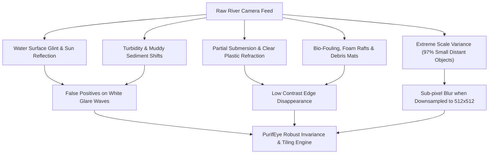
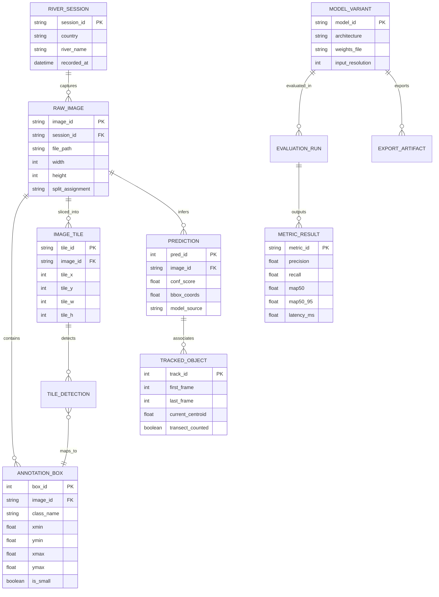
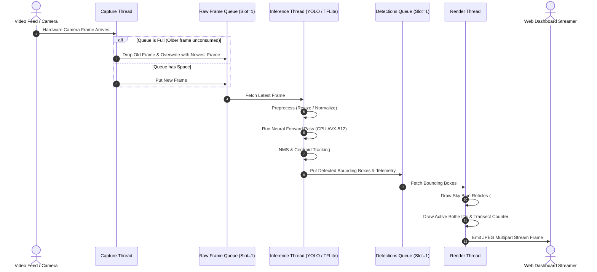
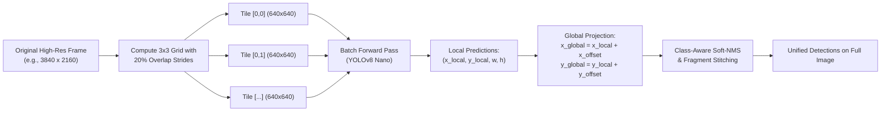
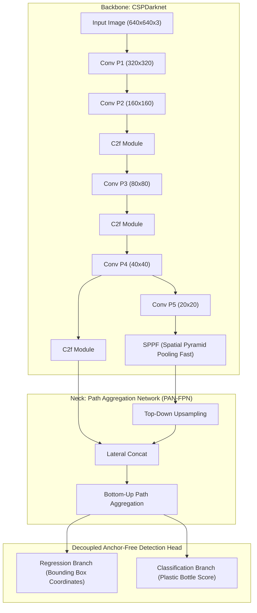
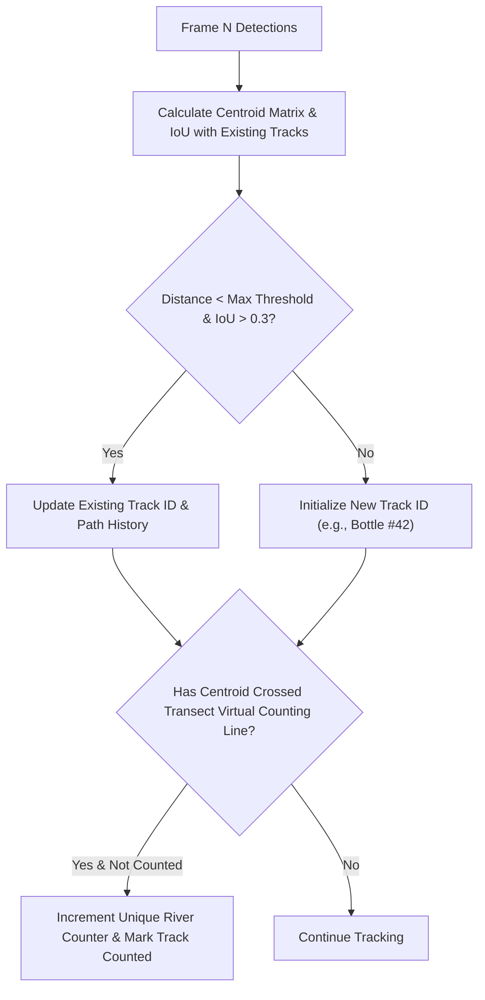

# TEACHME: The Technical & Deep Learning Guide to PurifEye

This guide is a comprehensive educational resource for understanding the real-world environmental challenges, software engineering best practices, deep learning architectures, and visual entity relationships implemented across the **PurifEye** platform.

---

## 📑 Table of Contents

1. [The Real-World Problem: River Plastic & Oceanic Discharge](#1-the-real-world-problem-river-plastic--oceanic-discharge)
2. [Environment Setup & Execution Guide](#2-environment-setup--execution-guide)
3. [Technical DO's and DON'Ts](#3-technical-dos-and-donts)
4. [Visual System Diagrams & ER Architecture](#4-visual-system-diagrams--er-architecture)
5. [Deep Learning Models & Computer Vision Techniques](#5-deep-learning-models--computer-vision-techniques)
6. [Self-Assessment & Conceptual Review](#6-self-assessment--conceptual-review)

---

## 1. The Real-World Problem: River Plastic & Oceanic Discharge

### 1.1 The Source of Ocean Plastics
Scientific research indicates that **over 80% of marine plastic waste enters the oceans through approximately 1,000 major rivers worldwide**. Rivers serve as municipal and industrial drainage channels, washing mismanaged consumer plastic from high-density urban areas directly into open seas.

Once polyethylene terephthalate (PET) bottles enter open ocean gyres:
* **Solar UV Photo-Oxidation:** Intense ultraviolet light breaks polymer bonds, causing the plastic to become brittle.
* **Mechanical Wave Kinetics:** Wave action continuously pulverizes brittle plastic into microscopic fragments (<5 mm).
* **Bio-Accumulation:** Microplastics enter the marine trophic web, absorbing hydrophobic toxins (e.g., PCBs, DDT) and eventually entering the human food supply.

**The Solution:** Interception at the river transect. Removing one intact plastic bottle from a river prevents thousands of microscopic fragments from contaminating ocean ecosystems.

---

### 1.2 Hydrodynamic & Computer Vision Challenges
Detecting floating plastic bottles in freshwater waterways presents severe computer vision obstacles that standard benchmark datasets (such as COCO or Pascal VOC) never encounter:



1. **Specular Glint & Water Reflections:** Direct vertical sunlight produces intense white glare spots that mimic clear or translucent bottle contours.
2. **Variable Water Turbidity:** Water color ranges from translucent mountain streams to dense silt-heavy volcanic brown (e.g., in Java and Indonesia) and algae green. Detectors cannot rely on static background colors.
3. **Refractive Index Matching:** Clean PET plastic has a refractive index ($n \approx 1.57$) close to water ($n \approx 1.33$). Once a bottle fills with water and submerges, its boundaries become nearly invisible.
4. **Extreme Small Object Dominance:** Data audits on the 5,592-image river dataset reveal that **96.99% of annotated bottles are smaller than $32 \times 32$ pixels or occupy less than 1% of the frame**. A naive downscaling of a 4K camera frame ($3840 \times 2160$) down to $512 \times 512$ collapses a 15-pixel distant bottle into a fraction of a single pixel, making standard detectors fail completely.

---

## 2. Environment Setup & Execution Guide

PurifEye is strictly engineered to run on **standard consumer CPUs without requiring an expensive GPU**.

### 2.1 Tooling & Requirements
* **Operating System:** Windows 10/11, Ubuntu 20.04+, or macOS.
* **CPU:** Any modern x86_64 or ARM64 processor (Intel Core i5/i7/i9, AMD Ryzen, Apple Silicon).
* **Python Runtime:** Python 3.12 standalone managed via [`uv`](https://docs.astral.sh/uv/).
* **Memory:** Minimum 8 GB RAM (16 GB recommended for 3x3 tiled batch processing).

---

### 2.2 Step-by-Step Installation

```powershell
# 1. Install uv (if not already installed)
# On Windows:
powershell -ExecutionPolicy ByPass -c "irm https://astral.sh/uv/install.ps1 | iex"
# On Linux / macOS:
curl -LsSf https://astral.sh/uv/install.sh | sh

# 2. Clone the repository and navigate into the root directory
git clone https://github.com/ManasKrishna-21/PurifEye.git
cd PurifEye

# 3. Synchronize environment and install pinned dependencies
uv sync

# 4. Verify test suite (11 unit tests covering conversion, tiling, and metrics)
uv run pytest tests/ -v
```

---

### 2.3 Running the System

#### A. Launch the Interactive Web Dashboard
```powershell
uv run uvicorn app.main:app --host 127.0.0.1 --port 8000
```
Open **`http://127.0.0.1:8000`** in your browser. The dashboard provides:
* **Live Detect:** Real-time webcam/stream detection and bottle counting.
* **Image Analyzer:** Single-image inference with tiling options.
* **Model Lab:** Side-by-side comparison of YOLOv8 Nano vs. AutoML TFLite.
* **Evaluation:** Standardized test metrics and PR curves.
* **Dataset Explorer:** Geographic distribution and contact sheets.
* **Edge Benchmarks:** Export matrix across runtimes.

#### B. Run the Automated Resumable Pipeline
```powershell
# Quick 2-minute smoke verification run:
uv run python pipeline.py --smoke

# Full production training and evaluation run:
uv run python pipeline.py
```

---

## 3. Technical DO's and DON'Ts

Following strict engineering rules ensures reproducible research, code hygiene, and deployment reliability:

| Category | ✅ DO | ❌ DON'T |
|---|---|---|
| **Package Tooling** | Use `uv sync`, `uv run`, `uv add`. All dependencies are locked in `uv.lock`. | Never use raw `pip install` or activate external global Python environments. |
| **Data Partitioning** | Group images by **river session/scene ID** into train, validation, and frozen test splits. | Never randomly shuffle images across splits! Same-scene images taken seconds apart cause severe spatial and temporal data leakage. |
| **Data Augmentation** | Apply river-appropriate augmentations: water turbidity color jitter, solar glint glare patches, and mild rotation ($\pm 15^\circ$). | Never apply vertical flips (`flipud`)! River water flows horizontally and bottles float on top of water—vertical flipping violates fluid gravity physics. |
| **High-Resolution Processing** | Use **$3 \times 3$ overlapped tiling** ($640 \times 640$ px with 20% stride overlap) and remap coordinates back to the full frame. | Never downsample $4\text{K}$ images directly to $512 \times 512$ for distant bottle detection. This destroys 97% of small objects. |
| **Concurrency & Streaming** | Use standard Python `threading.Thread` and single-slot `queue.Queue` with stale-frame dropping for live video. | Never use `async/await` for CPU compute-bound vision loops, and never use unbounded queues that cause live video lag. |
| **TFLite Windows CPU** | Use `OpResolverType.BUILTIN_WITHOUT_DEFAULT_DELEGATES` when initializing TFLite models. | Do not initialize standard XNNPACK delegates blindly on Windows CPU builds where multi-thread allocation can trigger runtime exceptions. |
| **Metrics Reporting** | Always report test split name, confidence threshold, IoU threshold, and exact hardware configuration alongside metrics. | Never fabricate metrics or present smoke-test subset numbers as full production benchmarks. |
| **Design System** | Use the strict **Ocean Blue & Deep Blue Design Tokens** (Canvas: `#060E1F`, Cards: `#0A1836`, Accent: `#38BDF8`, Primary: `#0284C7`). | Never introduce random green, orange, or olive color schemes into plots or web dashboard components. |

---

## 4. Visual System Diagrams & ER Architecture

### 4.1 System Entity-Relationship (ER) Diagram
This diagram represents the data domain entities, their attributes, and their relational mappings from raw capture to model evaluation:



---

### 4.2 Multi-Threaded Real-Time Video Execution Sequence
The live pipeline eliminates camera lag by decoupling video ingestion from CPU inference using dedicated threads and single-slot queues:



---

### 4.3 Tiling and Coordinate Projection Flow



---

## 5. Deep Learning Models & Computer Vision Techniques

### 5.1 Object Detection Foundations
Unlike **Image Classification** (which outputs a single categorical tag for an entire photo) or **Semantic Segmentation** (which classifies every single pixel), **Object Detection** locates specific items within a scene by regressing bounding box coordinates and calculating class probabilities:

$$\text{Detection Output} = \Big[ x_{\text{center}},\, y_{\text{center}},\, \text{width},\, \text{height},\, \text{confidence},\, \text{class\_id} \Big]$$

* **Confidence Score ($c \in [0.0, 1.0]$):** The probability that the bounding box contains a target object combined with how accurately the box fits the object.
* **Intersection over Union (IoU):** The ratio of the area of overlap between predicted box $A$ and ground truth box $B$ divided by the area of their union:

$$\text{IoU}(A, B) = \frac{\text{Area}(A \cap B)}{\text{Area}(A \cup B)} = \frac{\text{Area}(A \cap B)}{\text{Area}(A) + \text{Area}(B) - \text{Area}(A \cap B)}$$

---

### 5.2 YOLOv8 Nano Architecture
PurifEye utilizes **YOLOv8 Nano (`yolov8n.pt`)**, an anchor-free single-stage detector engineered for real-time edge speed.



#### Key Architecture Components:
1. **CSPDarknet Backbone with C2f Modules:** The Cross Stage Partial structure splits feature maps into two pathways, processing one through bottleneck residual blocks while skipping the other. This maximizes gradient flow, prevents vanishing gradients, and slashes redundant parameter counts.
2. **SPPF (Spatial Pyramid Pooling Fast):** Pools multi-scale receptive fields ($5\times5$, $9\times9$, $13\times13$) serially with minimal computational overhead, aggregating spatial context for large river foam patches.
3. **Decoupled Head:** Rather than forcing one convolution layer to predict class and box coordinates simultaneously, YOLOv8 decouples classification and bounding box regression into separate paths, accelerating convergence.
4. **Anchor-Free Detection:** Earlier models (YOLOv3/v4/v7) required manually tuned "anchor box" dimensions. YOLOv8 predicts distances directly from cell centers, eliminating anchor tuning and improving small-object generalization.

#### Loss Functions:
YOLOv8 optimizes three loss functions simultaneously:
* **Complete IoU Loss ($\mathcal{L}_{\text{CIoU}}$):** Penalizes overlap, distance between bounding box centers, and aspect ratio discrepancies:

$$\mathcal{L}_{\text{CIoU}} = 1 - \text{IoU} + \frac{\rho^2(b, b^{gt})}{c^2} + \alpha v$$

* **Distribution Focal Loss ($\mathcal{L}_{\text{DFL}}$):** Formulates box edge regression as a continuous probability distribution around ground-truth coordinates.
* **Binary Cross-Entropy ($\mathcal{L}_{\text{BCE}}$):** Penalizes classification errors.

---

### 5.3 Google AutoML MobileNet-SSD (Baseline)
The baseline model is an ultra-lightweight **MobileNet-SSD** compiled to TensorFlow Lite format (`.tflite`, ~2.8 MB):
* **Depthwise Separable Convolutions:** Decomposes standard 2D convolution into:
  1. *Depthwise Convolution:* A single spatial filter applied per input channel.
  2. *Pointwise Convolution:* A $1 \times 1$ convolution combining channel outputs.
  This achieves a **$8\times$ to $9\times$ reduction in computational operations (FLOPs)** with minimal accuracy loss.
* **TFLite CPU Delegate Architecture:** On Windows, default XNNPACK delegates can trigger memory allocation conflicts. PurifEye integrates `OpResolverType.BUILTIN_WITHOUT_DEFAULT_DELEGATES` to guarantee safe, deterministic 4-thread CPU execution.

---

### 5.4 Overlapped Tiling Mathematics & Fragment Stitching

When high-resolution images are processed:
1. An image of dimensions $(W, H)$ is subdivided into overlapping tiles of size $(T_w, T_h)$ with overlap ratio $\sigma = 0.20$ (20% overlap).
2. The stride step between adjacent tiles is:

$$S_x = T_w \times (1 - \sigma), \quad S_y = T_h \times (1 - \sigma)$$

3. Any box detected on tile $(i, j)$ with local coordinates $(x_{\text{local}}, y_{\text{local}})$ is reprojected into global coordinates via:

$$x_{\text{global}} = x_{\text{local}} + i \cdot S_x, \quad y_{\text{global}} = y_{\text{local}} + j \cdot S_y$$

4. **Fragment Merging:** When a bottle lies across the boundary between two adjacent tiles, both tiles will detect a partial fragment. Standard NMS might drop one fragment or leave two overlapping small boxes. PurifEye's custom `class_aware_nms` tests candidate boxes across tile boundaries and merges overlapping fragments if their combined envelope matches an expected plastic bottle aspect ratio.

---

### 5.5 Persistent Transect Object Tracking
Counting every detection in every frame causes massive overcounting: a bottle floating across a 30 FPS stream for 5 seconds would be counted $30 \times 5 = 150$ times!

PurifEye implements a **Centroid & IoU Transect Tracker**:



* **State Tracking:** Each object is stored with its track identifier, current centroid $(c_x, c_y)$, bounding box, consecutive disappeared frames counter, and a boolean `transect_counted` flag.
* **Transect Line Crossing:** A virtual detection transect line is drawn perpendicular to river flow. Only when a tracked bottle's trajectory vector crosses this line does the persistent accumulator increment.

---

### 5.6 Evaluation Metrics Formulations

$$\text{Precision} = \frac{\text{True Positives (TP)}}{\text{True Positives (TP)} + \text{False Positives (FP)}}$$

$$\text{Recall} = \frac{\text{True Positives (TP)}}{\text{True Positives (TP)} + \text{False Negatives (FN)}}$$

$$\text{F1 Score} = 2 \times \frac{\text{Precision} \times \text{Recall}}{\text{Precision} + \text{Recall}}$$

* **Average Precision (AP):** The area under the Precision-Recall curve:

$$\text{AP} = \int_{0}^{1} p(r) \, dr$$

* **mAP@50:** The Mean Average Precision evaluated at an IoU threshold of 0.50.
* **mAP@50-95:** The primary COCO metric—the average of 10 individual mAP evaluations computed from $\text{IoU} = 0.50$ to $\text{IoU} = 0.95$ in increments of 0.05.

---

## 6. Self-Assessment & Conceptual Review

Test your understanding of the technical principles behind PurifEye:

### Questions

1. **Why does splitting images randomly into train and test sets invalidate model evaluation on river datasets?**
   <details>
   <summary>Click to view answer</summary>
   River cameras often capture bursts of photographs seconds apart. Random splitting places virtually identical photographs of the exact same river patch, water ripple, and lighting into both train and test splits. The model merely memorizes the scene rather than learning generalizable plastic bottle features. Session-stratified splitting ensures test scenes are completely novel.
   </details>

2. **Why does a naive downscaling of river survey images to 512x512 cause poor recall?**
   <details>
   <summary>Click to view answer</summary>
   Over 96.9% of bottles in the dataset are small objects (<32x32 pixels in original resolution). Downscaling a 4K frame to 512x512 reduces these small bottles to sub-pixel blur. Overlapped 640px tiling preserves full pixel resolution so the neural network can identify small bottle necks and caps.
   </details>

3. **Why must live webcam systems use single-slot queues that drop stale frames instead of standard FIFO queues?**
   <details>
   <summary>Click to view answer</summary>
   If the neural network inference takes 35 ms but the camera captures at 30 FPS (33.3 ms per frame), a standard FIFO queue will slowly accumulate unprocessed frames. Over several minutes, the video display will lag tens of seconds behind real life. A single-slot dropping queue guarantees the inference engine always processes the freshest frame available.
   </details>

4. **Why are vertical flips (`flipud`) forbidden during river data augmentation?**
   <details>
   <summary>Click to view answer</summary>
   In the real physical world, water flows beneath gravity; bottles float on the upper meniscus of water with sky or bank reflections above them. A vertical flip inverts water and sky, creating physically impossible training examples that confuse the feature extractor.
   </details>
